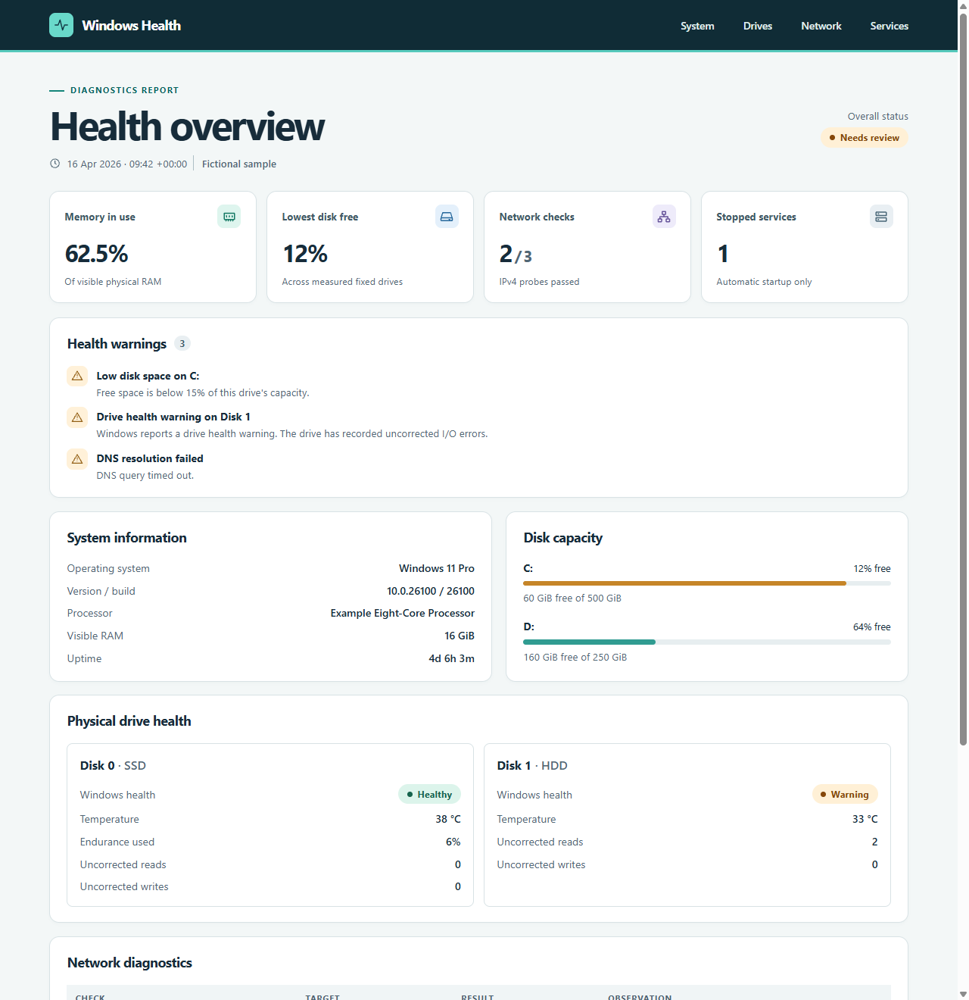

# Windows Health & Diagnostics Tool

A read-only PowerShell tool for first-pass Windows 11 troubleshooting. Run it from a standard PowerShell session to check SSD and HDD health, measure capacity, test three network paths, and list stopped automatic services. It produces a self-contained HTML dashboard and can export the same observations and findings to JSON.



[Open the fictional sample report](samples/sample-report.html) locally to explore the dashboard. The sample shows how an internet TCP connection can succeed while DNS fails.

## Quick start

Download or clone the project, open **Windows PowerShell** in the project folder, and run the following commands. The tool uses Windows PowerShell 5.1 and built-in Windows networking and CIM commands. PowerShell 7 on Windows also works. A writable project folder is required for exports.

```powershell
$result = .\Start-HealthCheck.ps1 -ExportJson
Invoke-Item -LiteralPath $result.HtmlPath
```

Omit `-ExportJson` for HTML alone. Each run creates uniquely named files under `reports\` next to the script. The returned object exposes `Status`, `HtmlPath`, and `JsonPath`.

To try the report offline using only fictional data, run:

```powershell
$demo = .\Start-HealthCheck.ps1 -Sample
Invoke-Item -LiteralPath $demo.HtmlPath
```

If a managed PC blocks script execution, follow your organization's approved script-running procedure. The bundled sample HTML opens directly in a browser.

## Checks and interpretation

| Check | Measurement | Review condition |
| --- | --- | --- |
| System | Windows edition, version and build, processor name, OS-visible RAM, time since last boot | Missing fields appear as unavailable |
| Memory | Used physical memory as a percentage of OS-visible memory | At or above 85% |
| Disk | Free and total capacity for each fixed logical drive, in GiB | Below 15% free on any measured drive |
| Physical drives | Windows health, media type, temperature, SSD endurance used, and uncorrected read/write counts | Windows reports Warning or Unhealthy, SSD endurance used reaches 100%, or either error count exceeds zero |
| Internet | TCP connection to Cloudflare at `1.1.1.1:443`, with a three-second timeout | TCP connection fails or times out |
| DNS | IPv4 address record for `example.com` using the local DNS configuration | Query fails or returns no IPv4 address |
| Gateway | ICMP echo to the lowest-cost active IPv4 default route's gateway, with a two-second timeout | Missing IPv4 default route or failed echo |
| Services | Automatic-start services in the Stopped state | One or more matches, listed by display name and service name |

**Needs review** means at least one health warning or stopped automatic service. **Incomplete** means a required measurement was unavailable and the remaining checks raised no findings. **Healthy** means all required checks returned data and raised no findings. A report can show warnings and missing data together.

### Reading drive health

Open **Drives** in the dashboard. Each card represents a physical device exposed by Windows. Drive letters in the capacity panel represent logical volumes. In the fictional sample, C: has little free space and Disk 1 has recorded two uncorrected reads. Each finding calls for a different follow-up.

Windows supplies the device health status. The checker also reads any reliability counters the driver exposes in the current session. Missing optional counters appear as **Unavailable** in HTML and `null` in JSON. A missing inventory or unknown Windows health status makes the overall check incomplete unless another finding needs review. Temperature is informational. A recorded error count is cumulative, so a single report cannot establish when an error happened. The checker runs without elevation and performs no surface scans or repairs.

JSON schema version 2 adds `Snapshot.PhysicalDrives` and the `DriveHealth` warning code. Exported drive labels use a local disk number or a report-local entry number. Serial numbers and unique hardware IDs are omitted.

A single endpoint measures one network path. A firewall can block ICMP, and a proxy-only network can block direct TCP connections. An on-link default route has no gateway address to ping, so the gateway check reports **Unavailable**. Check a service's role and triggers before treating a stopped state as an incident. The memory reading is a point-in-time measurement.

## JSON and privacy

The JSON contains a schema version, a `Snapshot` with measurements and per-probe outcomes, and a `Health` assessment with thresholds, warnings and missing fields. To read the warnings from a run made with `-ExportJson`:

```powershell
$data = Get-Content -LiteralPath $result.JsonPath -Raw | ConvertFrom-Json
$data.Health.Warnings | Format-Table Code, Title, Detail
```

Collection reads selected system properties, drive capacity, routing data and service metadata. It never enumerates private files, requests passwords, reads license keys, restarts services or changes system settings. The live network probes send ordinary TCP, DNS and ICMP traffic. The HTML works offline using embedded styles and icons.

Live exports can identify software, hardware, service names and the local gateway address. Keep them in the Git-ignored `reports\` directory. The ignore rules also cover HTML and JSON elsewhere in the project, except the explicitly included fictional sample HTML. The sample fixture, dashboard and preview image use fictional observations.

## Tests

From the project folder:

```powershell
powershell.exe -NoProfile -File .\tests\Run-Tests.ps1
```

The suite uses synthetic inputs and requires no modules, network access or administrative privileges. It checks both threshold boundaries, missing counters, per-probe failures, service inventory states, status precedence, provider failures and HTML escaping. A failed test returns exit code 1.

## Project layout

| Path | Purpose |
| --- | --- |
| `Start-HealthCheck.ps1` | Command-line entry point and local exports |
| `src/Collect.ps1` | Windows data collection and network probes |
| `src/Health.ps1` | Thresholds and health assessment |
| `src/Report.ps1`, `src/report.css` | HTML rendering and responsive layout |
| `samples/` | Fictional input, sample HTML and dashboard preview |
| `tests/Run-Tests.ps1` | Standalone PowerShell test runner |

## Windows references

- The OS reports free and visible physical memory in KiB. [Win32_OperatingSystem properties](https://learn.microsoft.com/en-us/windows/win32/cimwin32prov/win32-operatingsystem)
- The DNS probe requests an A record with DNS-only resolution. [Resolve-DnsName](https://learn.microsoft.com/en-us/powershell/module/dnsclient/resolve-dnsname)
- The gateway selection uses the sum of route and interface metrics. [Windows interface metrics](https://learn.microsoft.com/en-us/windows-server/networking/technologies/network-subsystem/net-sub-interface-metric)
- Windows defines drive health and media type in its [physical disk class](https://learn.microsoft.com/en-us/windows-hardware/drivers/storage/msft-physicaldisk). Counter definitions include temperature, endurance used, and uncorrected errors. [Storage reliability counters](https://learn.microsoft.com/en-us/windows-hardware/drivers/storage/msft-storagereliabilitycounter)
